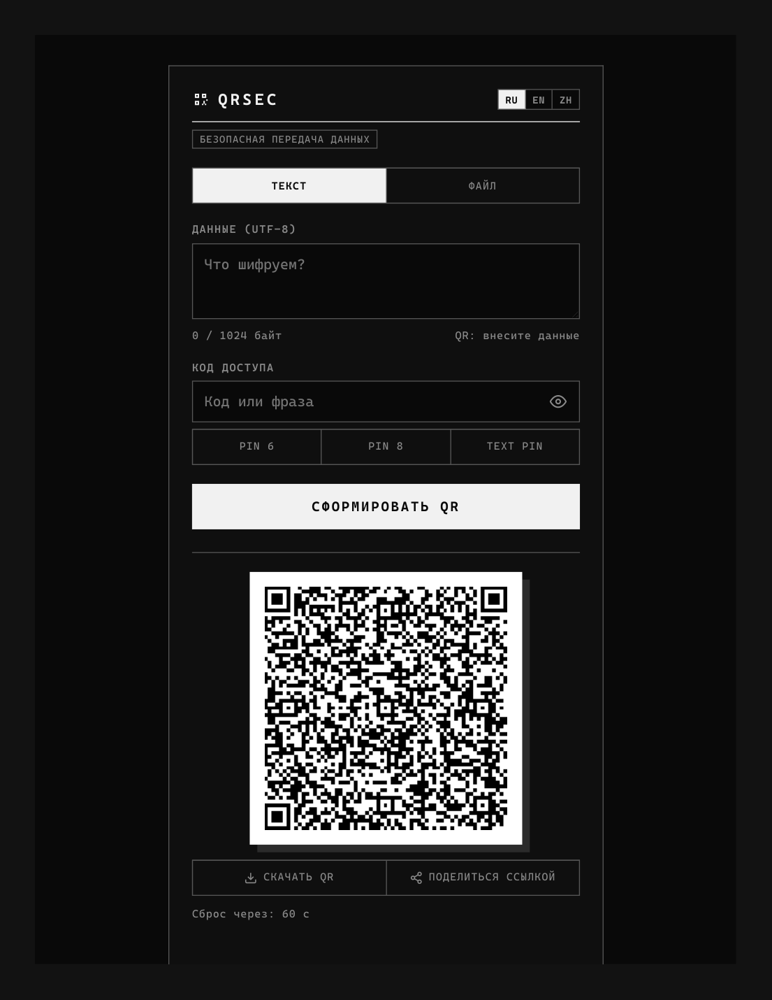
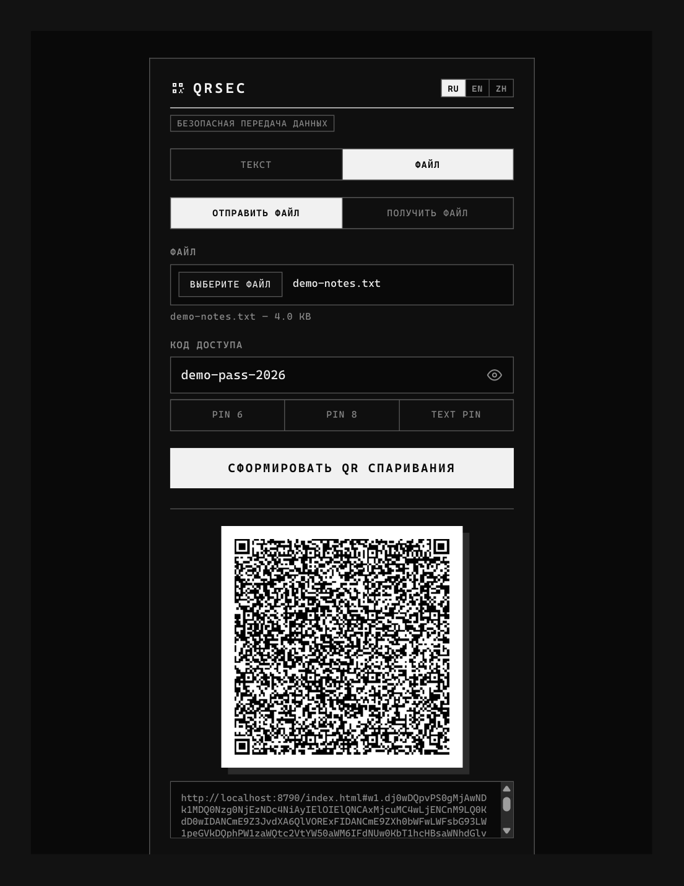

В обновлённую версию `README.md` (на всех трёх языках: RU, EN, ZH) внесены описания новых возможностей и улучшений протокола из исправленного `index.html`:

1. **Протокол P2P-передачи файлов (WebRTC):** добавлено описание мгновенной верификации пароля по зашифрованному тегу в заголовке (`hdr` с `authIv`/`authCt`) до начала приёма блоков, а также упоминание контроля потока (backpressure) для стабильной передачи крупных файлов.
2. **Улучшенный UX спаривания:** отражена возможность не только переходить по прямой ссылке/QR (`#w1....`), но и вручную вставлять ссылку или код `w1....` в режиме «Получить файл».
3. **Криптографически стойкий генератор кодов:** уточнено использование алгоритма без статистического смещения (rejection sampling без modulo bias) поверх `crypto.getRandomValues`.


---

# QRsec

**Безопасная передача данных и файлов через зашифрованный QR-код и P2P.**

*Read this in other languages: [Русский](#русский) · [English](#english) · [中文](#中文)*

**Live demo / Живое демо:** https://dee0x21.github.io/QRsec/

### Screenshots / Скриншоты / 截图

| Text mode (текст) | File mode — P2P pairing (файл) |
| --- | --- |
|  |  |

---

## Русский

Одностраничное веб-приложение без бэкенда: отправитель шифрует текстовые данные прямо в браузере или передаёт файлы напрямую (P2P), а получатель расшифровывает их по коду доступа. Сервер не видит и не хранит ничего — только отдаёт статические файлы.

### Возможности

* **Сквозное шифрование в браузере** — AES-GCM (256 бит), ключ выводится функцией PBKDF2 (SHA-256, 600 000 итераций) с уникальной криптографической солью.
* **Zero-Knowledge** — весь цикл «шифрование → QR → передача → расшифровка» происходит на стороне клиента через аппаратный Web Crypto API.
* **Передача по URL-фрагменту** — зашифрованный пакет или SDP-оффер передаётся в хэше ссылки (после `#`). По спецификации HTTP фрагмент никогда не отправляется на сервер и не попадает в access-логи.
* **QR + ссылка** — результат можно отсканировать камерой, скачать как PNG или отправить ссылкой (Web Share API / буфер обмена).
* **Обмен файлами P2P (WebRTC)** — файлы любого размера передаются напрямую между браузерами по WebRTC DataChannel с двойным шифрованием и контролем потока (см. ниже).
* **Генератор кодов доступа** — PIN на 6/8 цифр или текстовый код `xxxxx-xxxxx` на основе `crypto.getRandomValues` с отсечением смещения (rejection sampling без modulo bias).
* **Автосброс и защита данных**:
  * QR у отправителя текста автоматически сбрасывается через 60 секунд;
  * расшифрованный секрет у получателя показывается только при удержании (Tap & Hold), скрывается при потере фокуса вкладки и уничтожается из памяти через 30 секунд;
  * скопированный в буфер обмена секрет автоматически очищается через ~45 секунд.
* **Три языка интерфейса** — RU / EN / ZH, выбор сохраняется в `localStorage`, по умолчанию определяется из `navigator.language`.
* **Без внешних зависимостей** — библиотека QR лежит локально (`qrcode.min.js`), сторонние CDN не используются.

### Текстовый режим: формат пакета и схема передачи

Пакет имеет формат `nd1.<base64url>`:

| Поле | Размер | Описание |
| --- | --- | --- |
| `nd1.` | 4 байта (текст) | Префикс версии формата |
| version | 1 байт | Текущая версия — `0x01` |
| salt | 16 байт | Соль PBKDF2, генерируется заново при каждом шифровании |
| iv | 12 байт | Nonce для AES-GCM |
| ciphertext | N байт | Шифртекст + тег аутентичности GCM (мин. 16 байт) |

Лимит текстовых данных — **1024 байта** (UTF-8). При размере до ~768 байт плотность QR оптимальна для камер смартфонов.


```

Отправитель                          Получатель
─────────────                        ────────────

1. Ввод данных + кода доступа
2. PBKDF2(passphrase, salt) → ключ
3. AES-GCM encrypt(ключ, данные)
4. Пакет nd1.
5. URL: https://host/path#nd1....
│
├──► QR-код (отсканировать камерой)
└──► ссылка (Web Share / буфер обмена)
6. Браузер открывает URL,
читает хэш #nd1.... и очищает адресную строку
7. Ввод кода доступа
8. PBKDF2 → тот же ключ
9. AES-GCM decrypt → данные
10. Tap & Hold для просмотра,
авто-уничтожение через 30 с

```

### Обмен файлами (P2P WebRTC)

Файлы передаются напрямую между устройствами — без загрузки на облако и без участия сервера хостинга.

* **Гибкое спаривание через QR, ссылку или код** — отправитель генерирует «QR спаривания» (WebRTC offer в URL-фрагменте `#w1....`). Получатель может либо сразу открыть эту ссылку/QR, либо вручную вставить ссылку/код `w1....` во вкладке «Получить файл». В ответ получатель генерирует код `w2....` и передаёт его отправителю любым каналом (мессенджер, буфер обмена).
* **Двойное шифрование и мгновенная проверка кода** — транспорт WebRTC защищён протоколом DTLS, а поверх него каждый блок файла (по 32 КБ) шифруется алгоритмом AES-GCM (256 бит) с собственным 12-байтным IV и ключом из кода доступа (PBKDF2). Заголовок передачи (`hdr`) содержит зашифрованный проверочный токен (`authIv`/`authCt`), что позволяет мгновенно проверить правильность кода доступа ещё до приёма тела файла.
* **Контроль потока (Backpressure) и целостность** — при отправке контролируется заполнение буфера канала (`bufferedAmountLowThreshold`), что предотвращает обрывы соединения на больших файлах. По завершении приёма сверяется итоговый размер и контрольная сумма **SHA-256** всего файла.
* **Zero-Knowledge сохраняется** — публичный STUN-сервер (`stun.l.google.com:19302`) используется только для определения сетевых адресов (ICE-кандидатов) и не видит передаваемых данных.

**Ограничения P2P-режима:** оба устройства должны находиться онлайн одновременно; в сложных корпоративных сетях с симметричным NAT без TURN-сервера прямое соединение может не установиться (в одной локальной сети или при стандартном NAT работает штатно); на время приёма файл собирается в оперативной памяти браузера.

### Структура проекта


```

QR/
├── index.html      # Разметка, стили и вся логика приложения (монолит)
├── qrcode.min.js   # Локальная библиотека генерации QR (MIT)
├── screenshots/    # Скриншоты для README
└── README.md       # Документация (RU / EN / ZH)

```

### Запуск и использование

Web Crypto API и WebRTC работают только в **безопасном контексте** (HTTPS или `localhost`). Прямое открытие файла по протоколу `file://` заблокирует криптографию и обмен.

```bash
# Python
python -m http.server 8080

# Node.js
npx serve .

```

* **Передача текста:** Введите текст → задайте или сгенерируйте код доступа → нажмите «Сформировать QR» → покажите QR или отправьте ссылку. Код доступа сообщите отдельно.
* **Передача файла:** Перейдите во вкладку «Файл» → выберите файл и задайте код доступа → нажмите «Сформировать QR спаривания» → передайте QR/ссылку получателю → вставьте полученный от него ответный код `w2....` и нажмите «Подключить и передать».

---

## English

A zero-backend, single-page web application for encrypted text and P2P file sharing via QR codes and URL fragments. The sender encrypts text directly in the browser or streams files peer-to-peer, and the recipient decrypts them using a shared passcode. The hosting server never sees, processes, or stores any sensitive data.

### Features

* **In-Browser End-to-End Encryption** — AES-GCM (256-bit) with PBKDF2 key derivation (SHA-256, 600,000 iterations) and a unique 16-byte cryptographic salt.
* **Zero-Knowledge Architecture** — The entire lifecycle (encrypt → QR → transfer → decrypt) executes purely on the client side via the native Web Crypto API.
* **URL Fragment Privacy** — Encrypted payloads and WebRTC offers are placed in the URL hash (after `#`). Per HTTP specifications, the hash fragment is never sent to the web server or logged in access logs.
* **QR + URL Sharing** — Scan with a camera, download as a PNG image, or share the link via the Web Share API / clipboard.
* **P2P File Transfer (WebRTC)** — Files of any size travel directly between browsers over a WebRTC DataChannel with double encryption and backpressure flow control (see below).
* **Unbiased Passcode Generator** — Cryptographically secure 6/8-digit PINs and alphanumeric `xxxxx-xxxxx` codes powered by `crypto.getRandomValues` using rejection sampling (free of modulo bias).
* **Auto-Purge & Privacy Defense**:
* Sender QR view auto-clears after 60 seconds;
* Receiver plaintext is revealed only while holding the container (Tap & Hold), hides automatically on tab switch/blur, and is wiped from memory after 30 seconds;
* Copied clipboard secret is automatically cleared after ~45 seconds.


* **Tri-lingual UI** — Full RU / EN / ZH localization stored in `localStorage` with automatic detection via `navigator.language`.
* **Zero Remote Dependencies** — Bundled with a local `qrcode.min.js`; no external CDNs are used.

### Text Mode: Payload Format & Workflow

Format: `nd1.<base64url>`

| Field | Size | Description |
| --- | --- | --- |
| `nd1.` | 4 bytes (text) | Format version prefix |
| version | 1 byte | Current protocol version — `0x01` |
| salt | 16 bytes | Random PBKDF2 salt generated per encryption |
| iv | 12 bytes | AES-GCM initialization vector (nonce) |
| ciphertext | N bytes | Ciphertext + GCM authentication tag (min. 16 bytes) |

Maximum text payload size: **1024 bytes** (UTF-8). Payloads under ~768 bytes maintain optimal QR scanning density.

```
Sender                               Recipient
──────                               ─────────
1. Input data + passcode
2. PBKDF2(passphrase, salt) → Key
3. AES-GCM encrypt(Key, data)
4. Packet: nd1.<base64url>
5. URL: https://host/path#nd1....
        │
        ├──► QR code (camera scan)
        └──► Link (Web Share / clipboard)
                                     6. Open URL, parse hash #nd1....
                                        and strip hash from address bar
                                     7. Enter passcode
                                     8. PBKDF2 → Identical Key
                                     9. AES-GCM decrypt → Plaintext
                                    10. Tap & Hold to reveal,
                                        auto-purge after 30s

```

### P2P File Transfer (WebRTC)

Files travel directly between devices — no cloud uploads, and the static host is never involved in the traffic.

* **Flexible QR / Link / Manual Pairing** — The sender generates a "Pairing QR" (a WebRTC offer encoded in the URL fragment `#w1....`). The receiver can either open the link/QR directly or manually paste the link/`w1....` code into the "Receive File" tab. The receiver then generates a response code (`w2....`) and sends it back to the sender over any channel (messenger, clipboard).
* **Double Encryption & Instant Passcode Verification** — The WebRTC transport is secured by DTLS, and every 32 KB file chunk is additionally encrypted with AES-GCM (256-bit) using a fresh 12-byte IV and a key derived from the passcode (PBKDF2). The initial header (`hdr`) includes an encrypted authentication token (`authIv`/`authCt`) so wrong passcodes are rejected immediately before transferring chunks.
* **Backpressure Flow Control & Integrity** — The sender monitors `bufferedAmountLowThreshold` on the DataChannel to prevent buffer overflow on large files, while the receiver verifies both the byte length and the full-file **SHA-256** checksum upon completion.
* **Zero-Knowledge Preserved** — The public STUN server (`stun.l.google.com:19302`) only assists with NAT traversal metadata (ICE candidates) and never sees file contents.

**Limitations:** Both peers must be online simultaneously; restrictive symmetric NATs may prevent direct connection without a TURN server (connections on the same LAN or standard NATs work out of the box); received chunks are assembled in browser RAM before saving.

### Local Setup & Usage

The Web Crypto API and WebRTC require a **secure context** (HTTPS or `localhost`). Opening `index.html` directly via `file://` will restrict functionality.

```bash
# Python
python -m http.server 8080

# Node.js
npx serve .

```

* **Text Sharing:** Enter text → enter or generate a passcode → click "Generate QR" → share the QR or link. Share the passcode via a separate channel.
* **File Sharing:** Switch to the "File" tab → select a file and passcode → click "Generate Pairing QR" → share the QR/link with the recipient → paste their `w2....` response code and click "Connect & Transfer".

---

## 中文

无需后端的纯前端单页面 Web 应用：支持通过加密二维码与 URL 哈希片段安全传递文本，以及基于 WebRTC 的端到端 P2P 文件直传。发送方在浏览器本地加密数据，接收方凭访问密码解密。静态托管服务器仅提供页面文件，完全不参与计算，也无法截获或存储任何机密。

### 核心功能

* **浏览器原生端到端加密** — 采用 AES-GCM (256-bit) 标准，通过 PBKDF2（SHA-256，600,000 次迭代）配合 16 字节随机盐派生高强度密钥。
* **零知识架构 (Zero-Knowledge)** — “加密 → 生成二维码 → 传输 → 解密”全流程均在客户端通过原生 Web Crypto API 硬件加速运行。
* **URL 片段隐私隔离** — 加密数据包与 WebRTC 配对信息仅存放在链接的哈希部分（`#` 之后）。遵循 HTTP 规范，哈希片段绝不会发送至服务器，也不会出现在网络访问日志中。
* **二维码与链接双模分享** — 支持手机相机扫码、保存 PNG 二维码图片，或通过系统 Web Share API / 剪贴板分享链接。
* **P2P 文件直传 (WebRTC)** — 任意大小的文件通过 WebRTC DataChannel 在设备间直接传输，支持双重加密与流控防溢出机制（详见下文）。
* **无偏密码生成器** — 基于 `crypto.getRandomValues` 与拒绝采样算法（Rejection Sampling，消除模偏差），生成均匀分布的 6/8 位数字 PIN 或 `xxxxx-xxxxx` 格式口令。
* **防窥屏与数据自毁**：
* 发送端文本二维码展示 60 秒后自动超时清除；
* 接收端明文仅在按住容器（Tap & Hold）时显示，切换标签页或失去焦点时自动隐藏，30 秒后从内存中彻底擦除；
* 复制到剪贴板的敏感内容在约 45 秒后自动清空。


* **三语界面** — 完整支持 RU / EN / ZH，语言偏好持久化至 `localStorage`，默认自动匹配浏览器系统语言。
* **零外部依赖** — 本地内置 `qrcode.min.js`，不依赖任何第三方 CDN。

### 文本模式：数据包结构与流转架构

加密数据包规范：`nd1.<base64url>`

| 字段 | 大小 | 说明 |
| --- | --- | --- |
| `nd1.` | 4 字节 (字符) | 数据格式版本标识前缀 |
| version | 1 字节 | 当前协议版本号 — `0x01` |
| salt | 16 字节 | PBKDF2 随机盐，每次加密重新生成 |
| iv | 12 字节 | AES-GCM 初始化向量 (Nonce) |
| ciphertext | N 字节 | 密文主体 + GCM 认证标签 (不少于 16 字节) |

单次文本传输最大支持 **1024 字节** (UTF-8)。内容在 768 字节以内时，二维码密度最利于手机快速识别。

```
发送方 (Sender)                      接收方 (Recipient)
──────────────                      ─────────────────
1. 输入原始数据 + 访问密码
2. PBKDF2(密码, 盐) → 派生密钥
3. AES-GCM 加密(密钥, 数据)
4. 生成数据包: nd1.<base64url>
5. 拼接 URL: https://host/path#nd1....
        │
        ├──► 二维码 (手机镜头扫描)
        └──► 链接 (Web Share / 剪贴板)
                                     6. 打开链接，读取 #nd1.... 并自动清理地址栏哈希
                                     7. 输入解密密码
                                     8. PBKDF2 → 派生相同密钥
                                     9. AES-GCM 解密 → 还原明文
                                    10. 长按 (Tap & Hold) 查看明文，
                                        30 秒后内存自毁

```

### P2P 文件传输（WebRTC）

文件在设备之间点对点直传——无需上传云端，静态托管服务器不参与数据传输。

* **二维码 / 链接 / 手动粘贴灵活配对** — 发送方生成“配对二维码”（包含在 URL 片段 `#w1....` 中的 WebRTC offer）。接收方可以直接扫码/打开链接，也可以在“接收文件”界面手动粘贴链接或 `w1....` 代码；随后接收方生成响应码 `w2....` 并通过任意渠道（如即时通讯软件或剪贴板）发回给发送方。
* **双重加密与密码即时校验** — WebRTC 传输层受 DTLS 保护，同时每个 32 KB 文件分块均使用独立 12 字节 IV 和由访问密码派生的密钥（PBKDF2）进行 AES-GCM (256-bit) 加密。传输头部（`hdr`）包含加密校验标记（`authIv`/`authCt`），可在接收文件分块前立即拦截错误密码。
* **流控背压 (Backpressure) 与完整性校验** — 发送端通过监控 `bufferedAmountLowThreshold` 自动调节发送速率，防止大文件传输撑爆通道缓冲区；接收完成后严格核对文件总字节数与 **SHA-256** 校验和。
* **保持零知识特性** — 公共 STUN 服务器（`stun.l.google.com:19302`）仅用于协助获取网络连接候选地址（ICE），无法获知任何文件内容。

**限制说明：** 传输期间收发双方设备必须同时在线；在无 TURN 服务器的对称型 NAT（部分严格企业内网）环境下可能无法建立直连（同一局域网或常规网络下均可正常连通）；接收文件期间数据块暂存于浏览器内存中。

### 快速启动与使用

Web Crypto API 与 WebRTC 必须运行在**安全上下文**环境（HTTPS 或 `localhost`），直接以 `file://` 协议双击打开将被浏览器安全策略拦截。

```bash
# Python
python -m http.server 8080

# Node.js
npx serve .

```

* **发送文本：** 输入明文 → 输入或生成访问密码 → 点击“生成安全二维码” → 展示二维码或分享链接（密码请通过独立渠道告知对方）。
* **发送文件：** 切换至“文件”标签 → 选择文件并设置密码 → 点击“生成配对二维码” → 将二维码或链接发给接收方 → 粘贴对方发回的 `w2....` 响应码并点击“连接并传输”。

---

## License

MIT License.

Dependency: [`qrcode.min.js`](https://github.com/davidshimjs/qrcodejs) (MIT).